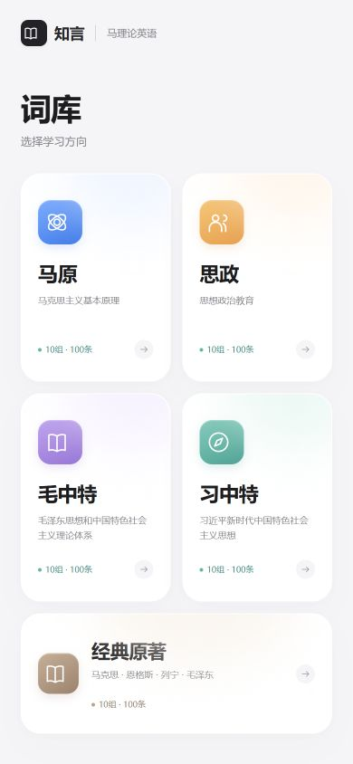

# 知言马理论英语

面向马克思主义理论考研、保研复试与日常学习的本地英语术语学习工具。

**下载后双击 `index.html` 即可使用。** 无需安装运行环境，无需启动服务器，也不需要 API Key。

## 内容

| 词库 | 分组 | 条目 |
| --- | ---: | ---: |
| 马原 | 10 | 100 |
| 思政 | 10 | 100 |
| 毛中特 | 10 | 100 |
| 习中特 | 10 | 100 |
| 经典原著 | 10 | 100 |

经典原著涵盖马克思、恩格斯、列宁和毛泽东，包含42个书名或篇名、58个重点术语。全库共500条，内置1000段术语和例句发音，下载完整后可离线学习。

## 下载与使用

1. 点击本页 **Code → Download ZIP**，或使用本地 Agent 下载仓库。
2. 解压到固定文件夹。
3. 双击文件夹里的 `index.html`，用 Edge、Chrome 或其他现代浏览器打开。
4. 选择词库和分组，开始学习或直接测验。

可选国内的 [WorkBuddy](https://www.workbuddy.cn/)、[豆包工作](https://www.doubao.com/work)、[TRAE](https://www.trae.cn/) 等，或海外的 Codex、Claude Code、Cursor 等。任选支持本地文件操作的工具，并启用本机文件夹访问能力。

本地 Agent 提示词：

```text
请把知言马理论英语下载到我的电脑并打开使用。
项目地址：https://github.com/lele2026startup-dot/zhiyan-marx-english
1. 识别当前电脑真实的桌面路径，包括可能使用的 OneDrive 桌面。在桌面新建“知言马理论英语”文件夹；若同名文件夹已存在，另建带日期的文件夹，不覆盖原文件。
2. 从这个公开仓库下载完整项目到该文件夹。有 Git 就克隆；没有 Git 就下载 GitHub 官方 ZIP 并解压，不必为此安装 Git。让 index.html 直接位于目标文件夹内。
3. 确认下载的是完整 HTML 成品，按照仓库 CHECKSUMS.txt 核对 index.html 的 SHA256；不要把 GitHub 网页、错误页面或链接文件当成成品。
4. 不修改源代码，不安装运行依赖，不启动服务器。用系统默认浏览器打开 index.html，然后告诉我入口文件和所在文件夹的完整绝对路径。
5. 如果没有本地文件权限或网络下载失败，请明确说明失败原因；不要声称下载成功，也不要重写一个替代软件。
```

也可以使用 Git：

```sh
git clone https://github.com/lele2026startup-dot/zhiyan-marx-english.git
```

下载后的 `index.html` 约38 MiB，包含完整音频；请保持下载完整。`CHECKSUMS.txt` 提供入口文件的 SHA256 校验值。

## 学习功能

- 每组10条，支持术语、中文、释义、练习句及参考出处。
- 术语与例句均可播放发音，不包含录音或语音输入。
- 分组测验、查看答案、错词重测与本地学习进度保存。
- 进度保存在当前浏览器的本地存储中，换浏览器、清理数据或更换文件位置可能影响进度。

## 使用指南

- [Word版下载与使用指南](docs/quickstart.docx)
- [PDF版下载与使用指南](docs/quickstart.pdf)

工具仅用于学习，不提供口语自动评分，也不承诺考试结果。词条的简释、口头练习句及中译为项目编写的学习材料，来源说明可在学习卡片中展开查看。

## 文件

- `index.html`：可直接打开的完整应用，HTML、样式、程序、词库及音频均内置。
- `vocabulary.json`：便于阅读和整理的词库副本。
- `docs/`：使用指南与界面预览。
- `LICENSE`：MIT开源许可，允许在保留许可与版权声明的条件下使用、修改和分发原创部分。
- `NOTICE.md`：内容和音频的来源说明。

本仓库公开，可免费下载。学习内容和程序源码均可在仓库中查看。


